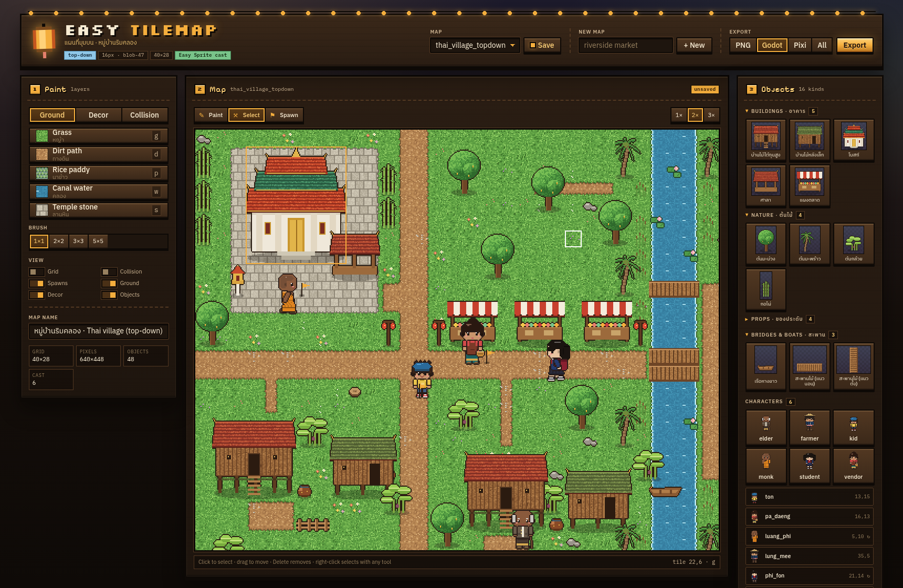
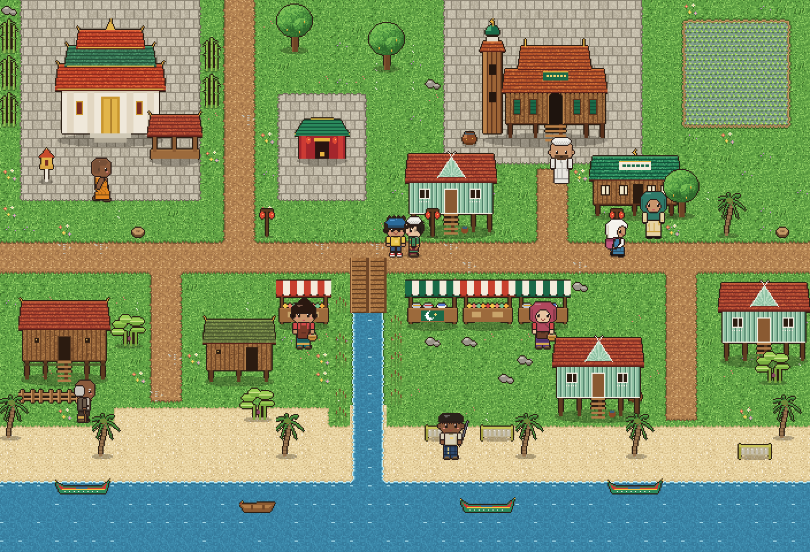
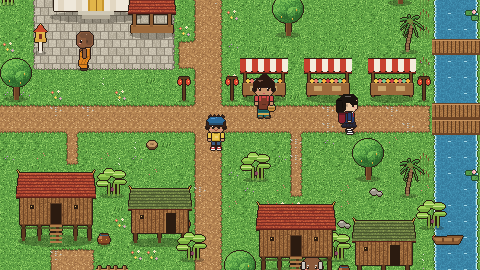
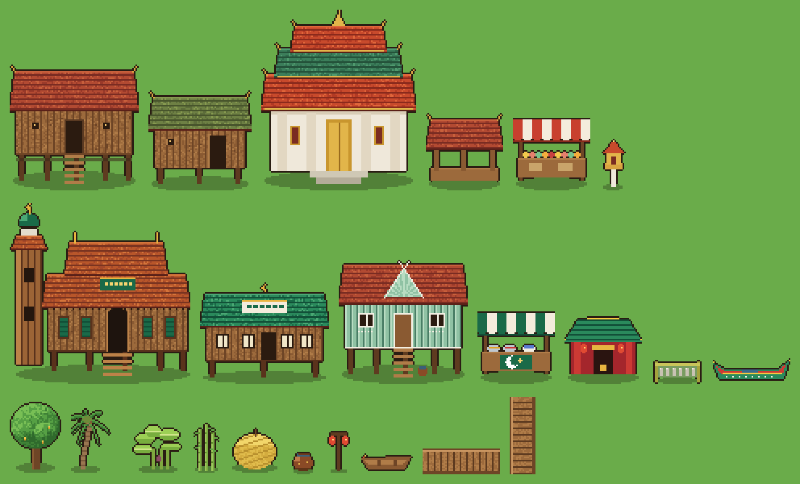

<!-- easy-suite:header:start -->
<p align="center">
  <a href="#easy-suite"></a>
</p>

<p align="center">
  <b>Easy Tilemap</b> · แผนที่มุมบน ออโต้ไทล์ หมู่บ้านไทย · Top-down 16px tile maps with autotiling<br />
  <sub>Part of <a href="#easy-suite"><b>Easy Suite</b></a>: Thai-friendly pixel-art game dev tools for Godot 4.3+ and PixiJS v8</sub>
</p>

<p align="center">
  <a href="https://github.com/Saladin2020/easytilemap/actions/workflows/ci.yml"></a> <a href="LICENSE"></a>  <a href="#export"></a> <a href="docs/MCP.md"></a> 
</p>

<p align="center">
  <a href="https://github.com/Saladin2020/easysprite"></a>
  <a href="https://github.com/Saladin2020/easyscene"></a>
  <a href="https://github.com/Saladin2020/easydialogue"></a>
  <a href="https://github.com/Saladin2020/easytilemap"></a>
  <a href="https://github.com/Saladin2020/easyquest"></a>
  <a href="https://github.com/Saladin2020/easysfx"></a>
  <a href="https://github.com/Saladin2020/easyui"></a>
</p>
<!-- easy-suite:header:end -->

# Easy Tilemap

**แผนที่มุมบน · ออโต้ไทล์ · หมู่บ้านไทย · ตัวละคร Easy Sprite**  
Paint top-down 16px pixel-art maps with blob-47 autotile terrain (grass, dirt road, rice paddy, canal, temple
stone, beach sand), a procedural Thai village tileset and object set, collision, spawn points and walking
[Easy Sprite](https://github.com/Saladin2020/easysprite) top-down characters — then export to **Godot 4.3+**
(TileMapLayer + terrain TileSet) or **PixiJS v8**. The fourth sibling of Easy Sprite (characters),
[Easy Scene](https://github.com/Saladin2020/easyscene) (side-view levels) and
[Easy Dialogue](https://github.com/Saladin2020/easydialogue) (dialogue).

[](https://nodejs.org)

> Easy Tilemap **paints · checks · renders · exports**. All tiles and objects are drawn procedurally in code
> — no AI generation in-app, no downloaded art.

<p align="center">
  
</p>

<p align="center">
  
</p>

<p align="center">
  
</p>

**Multicultural village · หมู่บ้านพหุวัฒนธรรม** — `multicultural_village` is a southern Thai coastal town where
Buddhist, Muslim and Chinese-Thai neighbours share one main road: the temple (วัด) and its sala, a Chinese-Thai
shrine (ศาลเจ้า), a Talo Mano-style wooden mosque (มัสยิด) with its minaret, a Tadika school (ตาดีกา), Malay
raised houses (บ้านมลายู) next to Thai stilt houses, fruit and halal stalls side by side, and a beach (หาดทราย)
where kolek boats (เรือกอและ) rest beside fish-drying racks. The cast mixes the Thai town characters with Muslim
neighbours from Easy Sprite (hijab teacher, kopiah boy, Pak Cik in jubah, Tadika girl, roti seller, fisherman in
kain pelekat). Spawns: `temple`, `shrine`, `mosque`, `tadika`, `market`, `beach`.

---

## What you get

| Terrain | Objects | Characters | Export |
| --- | --- | --- | --- |
| 6 terrains on a character grid, **blob-47** autotile transitions (47 tiles per terrain, corner-aware), beach sand with dedicated shore-water tiles, 8 grass variants + random terrain centres, 8 decor codes (flowers, lotus, reeds, fence…), collision layer (`#` block / `o` open) | 23 village kinds: stilt houses, temple (ubosot), sala, market stall, spirit house, wooden mosque, Tadika school, Malay kampung house, halal stall, Chinese-Thai shrine, fish rack, kolek, mango tree, palm, banana, bamboo, haystack, water jar, lantern post, long-tail boat, bridges — each with a solid footprint, y-sorted by base line | Easy Sprite **native top-down** sheets (front/right/back/left rows, idle + walk), placed by feet tile, facing + optional patrol path | Godot 4.3+ project (TileMapLayer ground + decor, `TileSet .tres` with terrain set + peering bits, AnimatedSprite2D characters with patrol, StaticBody2D collision, Marker2D spawns, Camera2D), PixiJS v8 loader + playable demo, PNG |

* **Collision you don't have to paint.** Water, object footprints and floor objects (bridges open the canal)
  are derived; the collision layer only overrides.
* **Same renderer everywhere.** The editor canvas, CLI, MCP previews and tests all use one TypeScript
  renderer; the Godot and Pixi exports reuse the same resolved atlas indices.
* **Agent friendly.** CLI with `--json` / `--ascii`, edit ops (`fill`, `paint`, `line`, `place`, `spawn`,
  `character`…), an HTTP API and an MCP server (stdio + HTTP) with 7 tools.

<p align="center">
  
  
</p>

<p align="center">
  
</p>

## Quick start

```bash
npm install
npx tsx src/cli.ts init --workspace ./my-map      # demo map, thai_village tileset + objects, top-down cast
npx tsx src/cli.ts serve --workspace ./my-map     # editor → http://127.0.0.1:8808/
```

Dev mode: `npm run dev` (API on 8808) + `npx vite --config web/vite.config.ts` (UI on 5176).

The editor: **Paint** (ground / decor / collision, brush 1–5, Shift+drag fills a rectangle), **Select**
(drag objects, spawns and characters; right-click selects with any tool; Delete removes), **Spawn**, object
and character palettes, inspector (name, facing, animation, flip, patrol), grid / collision / spawns overlays,
`Ctrl+S` save, `Ctrl+Z` undo, live diagnostics and export buttons.

## Map format in 20 lines

```json
{
  "format": "easytilemap/1",
  "id": "pond",
  "name": "บ่อบัว",
  "tileSize": 16, "width": 8, "height": 5, "tileset": "thai_village",
  "layers": {
    "ground":    ["gggggggg", "ggwwwwgg", "ggwwwwgg", "dddddddd", "gggggggg"],
    "decor":     ["f.......", "...l....", "........", "........", ".......t"],
    "collision": ["........", "........", "........", "........", "#......."]
  },
  "objects":    [{ "kind": "palm", "x": 6, "y": 0 }, { "kind": "bridge_v", "x": 3, "y": 1 }],
  "spawns":     [{ "name": "player", "x": 1, "y": 3, "facing": "right" }],
  "characters": [{ "sheet": "characters/town_kid.png", "name": "ton", "x": 1.5, "y": 3, "facing": "right",
                   "anim": "walk", "patrol": { "path": [[1, 3], [6, 3]], "speed": 24 } }]
}
```

Ground codes `g` grass · `d` dirt · `p` paddy · `w` water · `s` stone · `b` beach sand. Decor `f t r l e u n k`, `.` empty.
Full reference: **[docs/MAP_FORMAT.md](docs/MAP_FORMAT.md)**.

## CLI

```bash
easytilemap check thai_village_topdown --ascii          # errors with layer/cell + "did you mean"; exit 1 on errors (--strict, --json)
easytilemap new riverside --width 32 --height 20 --name "ริมคลอง"
easytilemap paint riverside --layer ground --code water --rect 10,0,3,20
easytilemap paint riverside --layer ground --code dirt --line 0,12,31,12 --width 2
easytilemap place riverside --object bridge_h --at 10,12
easytilemap spawn riverside --name player --at 4,12 --facing right
easytilemap character riverside --sheet characters/town_monk.png --at 6,8 --patrol "6,8;14,8"
easytilemap edit riverside --ops '[{"op":"place","kind":"sala","x":20,"y":4}]'
easytilemap render thai_village_topdown --scale 3 --crop 160,60,480,270 --out camera.png   # --grid --collision --spawns
easytilemap export thai_village_topdown --preset all     # png | godot | pixi | all
easytilemap catalog · list · info · tileset · serve [--port 8808]
```

(`npx tsx src/cli.ts …` from a checkout, `node dist/cli.js …` after `npm run build`.)

## Export

| Preset | Output (`exports/<id>-<preset>/`) |
| --- | --- |
| `png` | `<id>.png` at `--scale` (default 2) |
| `godot` | Godot 4.3+ project: `<id>.tscn` (Ground + Decor `TileMapLayer`, floor sprites, y-sorted `World` with object `Sprite2D`s and character `AnimatedSprite2D`s, `Collision` StaticBody2D with merged rectangles, `Spawns` Marker2Ds, Camera2D), `<id>_tileset.tres` (terrain set "match corners and sides" with 6 terrains + peering bits for every blob tile, so Godot's terrain painter keeps working), `character_patrol.gd`, `camera_pan.gd`, `test_map.gd`, `screenshot.gd`, 480×270 viewport, nearest filter |
| `pixi` | `<id>.tilemap.json` (resolved atlas indices, objects, characters, collision, spawns), atlas + object + sheet PNGs, `easytilemap-pixi.js`, playable `index.html` (arrow keys / WASD walk "ton" around with collision) |

**PixiJS v8**

```js
import { loadTilemap } from "./easytilemap-pixi.js";
const map = await loadTilemap(PIXI, "./thai_village_topdown.tilemap.json");
app.stage.addChild(map.view);
map.control("ton", { speed: 64 });                  // arrow keys / WASD, collides with map.isBlocked(px, py)
map.follow(map.characters.get("ton").sprite, 480, 270);
app.ticker.add((t) => map.update(t.deltaMS / 1000)); // patrols + camera
map.spawn("temple");                                  // { x, y, facing } in px
```

Drop `pixi.min.js` next to `index.html` to run offline; otherwise it loads PixiJS 8 from jsDelivr.

**Godot 4.3+** — open the exported folder and press F5 (arrow keys pan the camera), or copy the `.tscn`,
`.tres`, `tilesets/`, `objects/`, `characters/` and scripts into your project. Characters are
`AnimatedSprite2D` with `idle_<dir>` / `walk_<dir>` animations; spawns are `Marker2D` with
`metadata/facing`. Headless check: `godot --headless --path . --script res://test_map.gd`.

## Easy Sprite and Easy Dialogue

* **Characters** are Easy Sprite native sheets exported with the top-down view
  (`easysprite-cli export --preset native`): 48×48 frames, rows front/right/back/left, feet on row 45. The
  sheet's `.json` gives the frame layout; without one Easy Tilemap assumes the native layout and detects the
  feet row. Side-view sheets load with a warning. The sample cast (`town_kid`, `town_vendor`, `town_monk`,
  `town_farmer`, `town_student`, `town_elder`) is the same Thai town cast Easy Dialogue uses for portraits; `multicultural_village` adds Muslim neighbours
  (`town_hijab_teacher`, `town_kopiah_boy`, `town_pak_cik`, `town_tadika_girl`, `town_roti_seller`, `town_fisher`).
* **Spawns** in the demo (`player`, `market`, `temple`, `farm`, `elder_house`) are the targets of
  `@camera …` events in Easy Dialogue's `village_delivery.ezd`: on `event_fired("camera", ["temple"])`, move
  the camera to the `temple` Marker2D (Godot) or `map.spawn("temple")` (Pixi).

## MCP

`npm run mcp` (stdio) or `npm run mcp:http` (`http://127.0.0.1:8809/mcp`). Tools: `workspace_info`,
`list_maps`, `get_map`, `write_map`, `edit_map`, `render_map`, `export_map`. See **[docs/MCP.md](docs/MCP.md)**.

## Security

The server binds to `127.0.0.1` by default and rejects cross-origin writes and non-loopback `Host` headers.
`--host 0.0.0.0` requires the token printed at startup (or `EASYTILEMAP_TOKEN`). API and MCP paths stay
inside the workspace plus `EASYTILEMAP_ALLOWED_DIRS`.

## Development

```bash
npm run typecheck && npm test && npm run build && npm run smoke
GODOT=/path/to/godot npx vitest run test/godot.test.ts      # import the export headless, compare node/tile counts
npm run docs:images                                         # README images from the samples
python3 scripts/check-pixi.py exports/thai_village_topdown-pixi   # headless Chrome: walk + collide, no console errors
python3 scripts/capture-ui.py                              # editor screenshot (server on :8808)
npx tsx scripts/build-samples.mts                          # regenerate samples/maps from src/lib/demoMaps.ts
```

Ports: API / editor 8808 · MCP HTTP 8809 · Vite 5176.

<!-- easy-suite:table:start -->
## Easy Suite


Seven small, local-first tools that share one look (teak, lantern gold, Kanit, 16/48px pixels), one
workflow (CLI · web editor · MCP server) and the same targets (**Godot 4.3+** and **PixiJS v8**).
ชุดเครื่องมือทำเกมพิกเซลสไตล์ไทย ใช้ร่วมกันได้ทั้งชุด  
The samples share one multicultural southern Thai village: Buddhist temple, wooden kampung mosque and
Chinese-Thai shrine on the same street. หมู่บ้านพหุวัฒนธรรม วัด มัสยิด ศาลเจ้า อยู่ร่วมกันในเมืองเดียว

| | Tool | What it does | Repo |
|:-:|---|---|---|
|  | [**Easy Sprite**](https://github.com/Saladin2020/easysprite) | Compose modular 48px chibi characters (top-down + side-view) and export sheets. | [`easysprite`](https://github.com/Saladin2020/easysprite) |
|  | [**Easy Scene**](https://github.com/Saladin2020/easyscene) | Side-view levels: parallax layers, 16px autotiles, Thai town props. | [`easyscene`](https://github.com/Saladin2020/easyscene) |
|  | [**Easy Dialogue**](https://github.com/Saladin2020/easydialogue) | Branching `.ezd` dialogue with Thai-safe text, portraits and choices. | [`easydialogue`](https://github.com/Saladin2020/easydialogue) |
|  | **Easy Tilemap** ← you are here | Top-down 16px maps: blob-47 autotiles, objects, collision, spawns. | [`easytilemap`](https://github.com/Saladin2020/easytilemap) |
|  | [**Easy Quest**](https://github.com/Saladin2020/easyquest) | Text `.ezq` quests: steps, flags, items, rewards, linked to dialogue. | [`easyquest`](https://github.com/Saladin2020/easyquest) |
|  | [**Easy SFX**](https://github.com/Saladin2020/easysfx) | Deterministic 8-bit SFX and 4-channel chiptune loops, typing blips. | [`easysfx`](https://github.com/Saladin2020/easysfx) |
|  | [**Easy UI**](https://github.com/Saladin2020/easyui) | Nine-slice pixel UI kit: panels, bars, inventory, menus, 30 icons. | [`easyui`](https://github.com/Saladin2020/easyui) |

### Works with

- **Easy Sprite** top-down sheets are the walking characters.
- Spawn names are the targets of **Easy Dialogue** `@camera` events and **Easy Quest** `enter` / `talk` triggers.
- **Easy SFX** and **Easy UI** layer sound and HUD over the exported map.
<!-- easy-suite:table:end -->

## Credits

Tileset, objects and icons are drawn procedurally and released as CC0. Sample cast composed with Easy Sprite.
See [CREDITS.md](CREDITS.md). Code: MIT © Salahuddin Benno.
